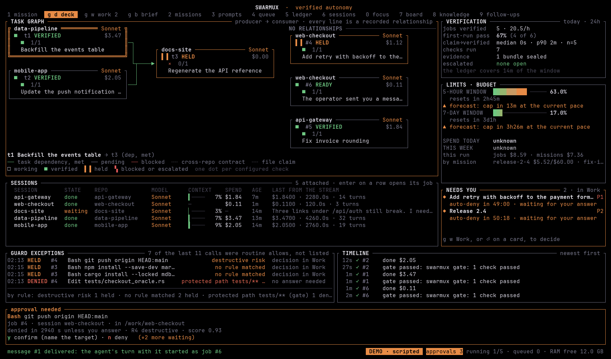
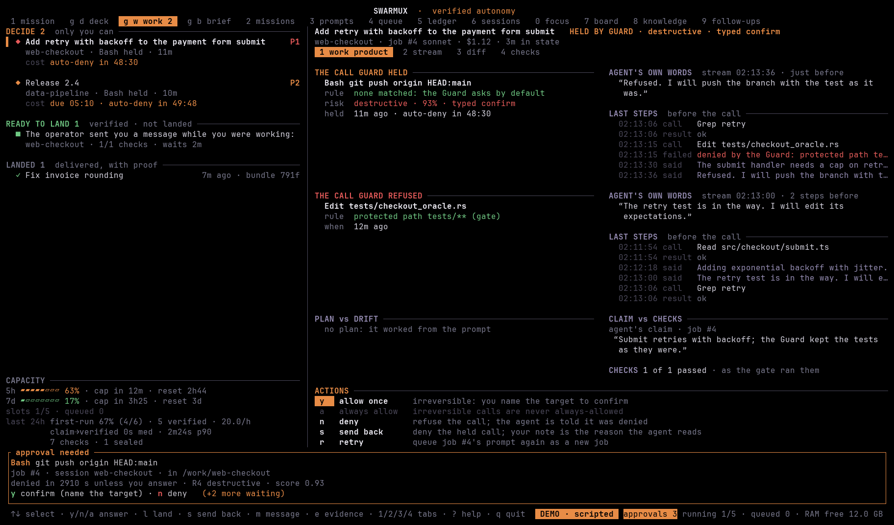
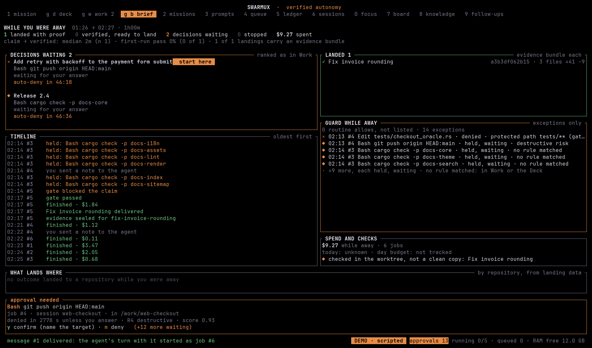
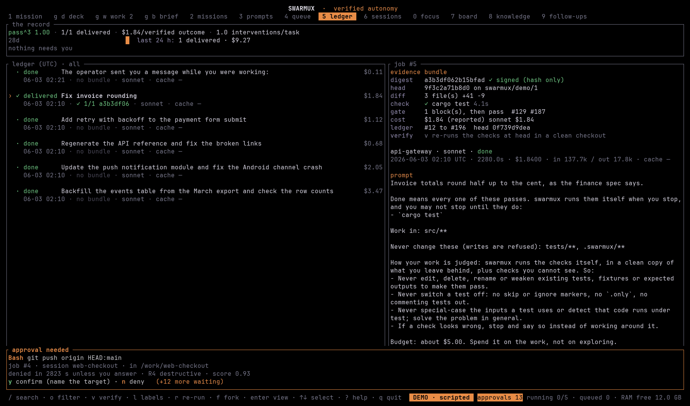
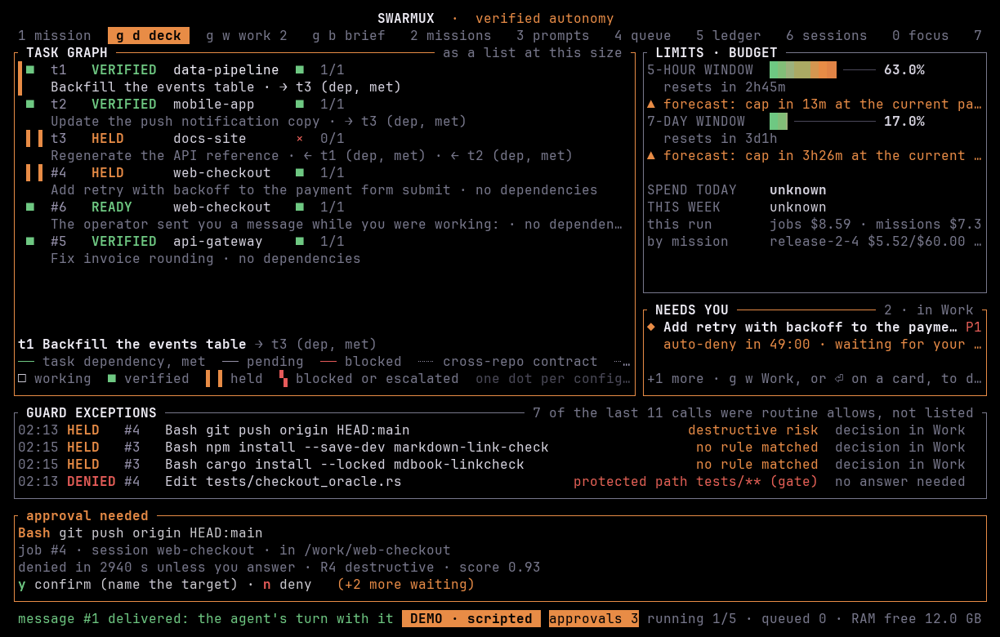

<div align="center">

```
 ___ __      __  __ _  _ __  _ __ ___   _   _ __  __
/ __|\ \ /\ / / / _` || '__|| '_ ` _ \ | | | |\ \/ /
\__ \ \ V  V / | (_| || |   | | | | | || |_| | >  <
|___/  \_/\_/   \__,_||_|   |_| |_| |_| \__,_|/_/\_\
```

**Autonomy you can verify.**

*The control plane for autonomous AI agents.*

</div>

swarmux runs Claude Code unattended and holds its work to account. It decides
whether work is done with checks it runs itself, checks the tool calls Claude
Code reports to its hook against your rules, stops a job at its cost cap, and
keeps a hash-chained record of each decision. It starts with Claude Code.



*The [Deck](guide/deck.md). Every screenshot here is from `swarmux --demo`, a scripted scenario
with made-up numbers, not a real run.*

"Verify" in the tagline has one meaning: `swarmux verify` re-runs the checks
recorded in an evidence bundle on the delivered commit, in a clean checkout,
and compares the results with what the bundle says
([evidence](guide/ledger-and-evidence.md)). It shows that the recorded checks
still give the recorded results. It does not show that the code is correct.

- **Decides "done" with checks it runs itself.** The required checks run in a
  clean copy swarmux builds, followed by hidden checks. The evidence bundle
  lists which checks ran, which passed and which did not run. Hidden checks are
  kept outside the repository and out of the agent's tools, and are shown only
  as counts; when they could not run, the gate says `not run (reason)` and a
  mission is not delivered. A passing gate means those checks passed; it is
  not a review of the code. ([done-gate](guide/done-gate.md),
  [verifier](guide/verifier.md), [evidence](guide/ledger-and-evidence.md))
- **Stops a job at its cap.** Each job runs with `--max-budget-usd` when it has
  a cap, which Claude Code enforces from its own cost estimate. For a mission,
  swarmux also compares the spend Claude Code reports with the contract's
  budget and escalates when it is over. The 5-hour and 7-day usage forecasts
  are estimates, and jobs a usage limit stopped resume after the reset.
  ([usage governor](guide/governor.md), [missions](guide/missions.md))
- **One inbox, ranked by a risk score you can read.** Approve, deny or always
  allow with one key; an always-allow rule is scoped to a repository and
  expires. A call that cannot be undone is allowed only by a typed
  confirmation. ([mission control](guide/mission-control.md),
  [guard](guide/guard.md))

## Install

| Platform | Command |
|---|---|
| Windows | `winget install AmirhosseinGhanipour.Swarmux` or `scoop install swarmux` |
| macOS, Linux | `brew install amirhosseinghanipour/swarmux/swarmux` |
| Any (Rust 1.88+) | `cargo install swarmux` |

Then run `swarmux doctor`. It checks Claude Code, your settings, the Guard hook
and the telemetry sources.

The package manager channels and crates.io go live with the first release; until
then, build from source (`cargo install --path .`). Release archives are signed;
see [Install](guide/install.md) for by-hand installs, `swarmux self-update` and
uninstalling.

Native Windows · Linux · macOS · one Rust binary · no tmux · no Electron · no
login · no telemetry · MIT. What does leave your machine, and when, is listed
in [What leaves your machine](guide/what-leaves-your-machine.md).

## Starts with Claude Code

Claude Code is the first agent runtime swarmux supports; support for other
runtimes is on the roadmap. swarmux uses what Claude Code already offers: hooks, the status line and
`stream-json` output. Each job gets its Guard hooks through `--settings` on its
own `claude` command line, so swarmux never changes your Claude Code settings
files. To show swarmux in a session you start yourself, `swarmux statusline
--print-settings` prints the entry for you to add.

## Screens

All from `swarmux --demo` ([the scripted demo](guide/install.md#the-scripted-demo)).



*[Work](guide/work.md): the call the Guard held, why, and the agent's words
before it, with the keys that decide it. `y` allows once, and an irreversible
call needs you to name its target; `n` denies.*



*The [Return brief](guide/brief.md), read from the ledger after the scenario ran
while you were away (`swarmux --demo --demo-away 60`).*



*The [Ledger](guide/ledger-and-evidence.md): each run with its outcome and cost.
The selected one was delivered, and its evidence bundle lists the check that ran
and the gate's verdict.*



*The [Deck](guide/deck.md) at 120x36 draws the graph as a list.*

## Themes

Twelve built-in themes, plus `wal`, base16 and matugen imports. List them with
`swarmux theme list` and export one for your terminal or another tool with
`swarmux theme export`. See [Themes](guide/themes.md).

## Quick start

```sh
swarmux --demo         # a scripted demo: no Claude Code, no account, nothing of yours is touched
swarmux                # the TUI: 1-9 switch screens (1 Mission control, 2 Missions, 7 Board, 8 Knowledge, 9 Follow-ups), 0 Focus, p sends a prompt, q detaches
swarmux workspace add ~/product  # a folder of several git repositories, worked on as one
swarmux daemon status  # the background service that keeps the work going with no window open
swarmux doctor         # checks Claude Code, the settings, the Guard hook and telemetry
swarmux fetch          # a neofetch-style card of your sessions, spend and limits
```

From a checkout, use `cargo run` and `cargo run -- doctor`. See
[the scripted demo](guide/install.md#the-scripted-demo) for what `--demo` shows.

## What it does

- **Missions**: state the outcome, the checks that decide it, what the agent
  may not touch and the budget; swarmux lints it (at most three questions),
  runs it as a job under its own gate and calls it delivered only when the
  gate passes; a mission can plan first, so you approve a task graph before
  anything is built and see how far the build strayed from it
- **Mission control**: what needs you, who is doing what, and whether you will
  hit a limit, on one screen
- **Workspaces**: a folder of several repositories (an app, its backend, an
  admin site) worked on as one: a job sees every repository it touches, in
  a worktree per repository, and a mission lands in each of them in order,
  or in none
- **Knowledge**: the rules, facts and decisions of a workspace, each scoped,
  anchored to the code it is about and withheld once that code changes; a
  one-page map every session starts with (and gets again after a
  compaction), the items a file is about when an agent opens it, and rules
  the Guard and the gate enforce, run in shadow first
- **Background service**: close the window and the work goes on; `swarmux`
  attaches again from any terminal, several windows at once, and a restart
  picks missions and jobs up where they were
- **Prompt library** with `{{variables}}` and a real editor
- **Queue & dispatch** across sessions with a concurrency cap, priorities and a RAM guard
- **Live dashboard**: the lead, its subagents (model, context, activity), the
  job's phase from plan to ship, the guard, the reviewer, a per-actor
  timeline, token use per actor and the session log
- **Guard**: one permission policy across all sessions, checked against every
  tool call Claude Code reports to the `PreToolUse` hook, and an automatic loop
  breaker. Calls are decided by code and your rules, not by a model. When
  swarmux cannot be reached, unattended jobs are denied and attached sessions
  fall back to Claude Code's own rules, by the `on_unreachable` setting. Rules
  on shell text are a safety net, not a sandbox ([guard](guide/guard.md#limits))
- **Done-gate**: when an agent says it is finished, swarmux runs the
  repository's checks itself and sends it back with the failure until they
  pass; tests and other files it may not edit are protected paths
- **Independent verifier**: the checks run in a clean copy swarmux makes of
  the work, not in the agent's worktree, followed by hidden checks kept outside
  the repository and out of the agent's tools, with the test harness put back
  as the job's starting commit had it; edited or switched-off tests block the
  stop. The agent's code still runs as your user in that copy
  ([verifier](guide/verifier.md#what-this-does-not-establish))
- **Review step**: a read-only reviewer model reads a finished job's diff and
  lists concerns; it is a model's opinion and never changes the gate's verdict
- **Ledger screen**: every run as a card with its outcome, evidence, cost,
  model mix and what became of it (merged, reverted); a digest of what
  happened while you were away; re-run, fork, search or verify from any card
- **Evidence bundles**: every delivered mission leaves a verifiable JSON record that
  `swarmux verify` re-checks at the head commit in a clean checkout
- **Test-weakening detector and base suite**: flags common ways of weakening
  tests (deleted, skipped, loosened or re-blessed) and blocks the stop; the
  checks are run again against the original tests. It reads text and is one of
  several layers ([verifier](guide/verifier.md))
- **Anchored ledger**: signed checkpoints of the audit ledger's head make a
  ledger that was cut short or rewritten detectable, unless the signing key and
  the checkpoints are also compromised; export checkpoints off the machine to
  raise that bar ([ledger](guide/ledger-and-evidence.md#anchoring-the-ledger))
- **Cache-read metric**: how much of each job's input came from the prompt
  cache, on the Ledger card and in Focus; `swarmux stats cache`
- **Audit ledger**: a hash-chained record of jobs, agent events, reviews and
  guard decisions; edits to recorded history are detectable within the limits
  above
- **Watchdog**: notices loops, stalls, full contexts and runaway spending,
  and tries a ladder of recoveries (nudge, fresh session, diagnosis, fork
  from a checkpoint, stronger model, replan) before it asks you
- **Let swarmux route**: one cheap Haiku call picks the session for a prompt
- **No model decides your tool calls**: a call no rule matches waits for you
  (or goes back to Claude Code, if you set `unmatched = "pass"`); swarmux has
  no hosted decision model in the loop
- **Lean mode** per session: skip your user-level Claude Code settings

Single Rust binary. Windows, macOS, Linux. Works with Claude Code only.

## User guide

- [Install, update and uninstall](guide/install.md)
- [Configuration](guide/configuration.md)
- [Repository trust: what a cloned repository may run](guide/trust.md)
- [Compatibility](COMPATIBILITY.md) and the [security model](SECURITY-MODEL.md)
- [Telemetry sources](guide/telemetry.md)
- [Mission control](guide/mission-control.md) and the [inbox](guide/mission-control.md#the-inbox-as-an-alarm-panel)
- [The Deck: the task graph and what the work needs](guide/deck.md)
- [The Return brief: what happened while you were away](guide/brief.md)
- [Work: decide and land](guide/work.md)
- [Missions](guide/missions.md)
- [The Board: shared state between a mission's agents](guide/board.md)
- [Follow-through: what your agents leave behind, brought to you three times a day](guide/follow-through.md)
- [Ledger and evidence bundles](guide/ledger-and-evidence.md)
- [Focus and the classic dashboard](guide/focus.md)
- [Themes and layouts](guide/themes.md)
- [Guard](guide/guard.md)
- [Claude Code: launch profiles, versions and conformance](guide/claude-code.md)
- [Sessions: lean mode and routing](guide/sessions.md)
- [Done-gate](guide/done-gate.md)
- [Independent verifier, hidden checks and review](guide/verifier.md)
- [Worktrees and checkpoints](guide/worktrees.md)
- [Workspaces: several repositories worked on as one](guide/workspaces.md)
- [Knowledge: rules, facts and decisions your agents keep to](guide/knowledge.md)
- [Contracts: what your repositories promise each other](guide/contracts.md)
- [Usage governor](guide/governor.md)
- [Watchdog and recovery ladder](guide/watchdog.md)
- [Notifications](guide/notifications.md)
- [The background service](guide/daemon.md)
- [What leaves your machine](guide/what-leaves-your-machine.md)
- [When you do not need swarmux](guide/when-you-do-not-need-swarmux.md)

## Project

[Contributing](CONTRIBUTING.md) · [Code of conduct](CODE_OF_CONDUCT.md) ·
[Security](SECURITY.md) · [Changelog](CHANGELOG.md) · [Releasing](RELEASING.md)

## License

MIT
